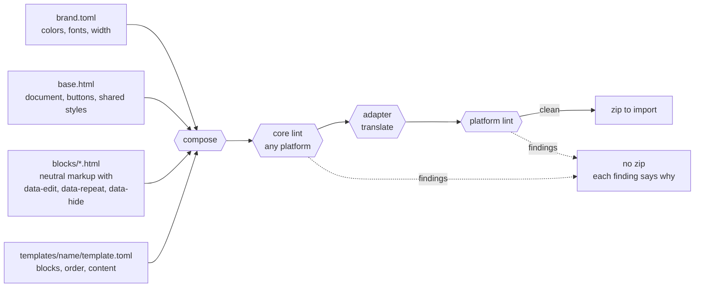

# Editable email builder

Build email templates from a design, such as a Figma frame, that stay editable inside your email platform. Every text, button and photo opens in the platform's editor, and colors and sizes change from its style panel. Nothing is pasted in as a block of code that only a developer can touch.

The first supported platform is Mailchimp, through its template language. The builder keeps the platform at the edge: blocks are written once in neutral markup, and an adapter translates them for each platform.

## What you get

- **Reusable blocks.** A promo strip, two headers, an offer card, a product row, a call to action and a legal footer. A new email combines blocks in a `template.toml`.
- **One brand file.** `brand.toml` holds every color and font. The lint rejects anything else.
- **A lint that explains itself.** 31 rules check editability, email client support, brand and legal requirements, plus what the platform needs. Each finding says why the rule exists. When a rule fails, no zip is written.
- **Tests that prove the lint.** Every rule fires on a planted violation in `tests/test_rules.py`. A rule without a case fails the suite.

## Quick start

You need Python 3.11 or later. The `image` and `preview` commands also need Pillow and Playwright.

1. Build the example template:

	```sh
	python3 -m eeb build example
	```

	You get `dist/mailchimp/example/index.html` and `dist/mailchimp/example.zip`.

2. Look at it at desktop and mobile widths:

	```sh
	pip install pillow playwright && playwright install chromium
	python3 -m eeb preview example
	```

3. In Mailchimp, create a template with **Import HTML**, upload the zip and open it with the classic email builder.

## How it works



[How it works](docs/how-it-works.md) explains the neutral markup, the adapters and the lint layers.

## Documentation

- [How it works](docs/how-it-works.md): the pipeline, the neutral markup and why it is built this way.
- [Build a new email from a Figma design](docs/new-email.md): the steps, from the frame to the import.
- [Blocks](docs/blocks.md): every block, its fields and its editable names.
- [Mailchimp](docs/mailchimp.md): how the template language behaves, and what no rule can check.
- [Add an email platform](docs/adding-an-adapter.md): what an adapter needs and what to find out first.
- `python3 -m eeb rules` lists every lint rule with its reason.

## Commands

| Command | What it does |
|---|---|
| `python3 -m eeb build <template> [--esp NAME]` | Compose, lint, translate, lint again and write the zip |
| `python3 -m eeb preview <template> [--esp NAME]` | Screenshots at 700 and 375 px |
| `python3 -m eeb image <src> <dest> --width N` | Crop, scale, darken and compress an image. Rasterizes SVG |
| `python3 -m eeb rules [--esp NAME]` | List the rules and their reasons |
| `python3 -m eeb esps` | List the supported platforms |
| `python3 -m unittest discover -s tests -t .` | Prove that every rule fires |

## License

MIT. See [LICENSE](LICENSE).
