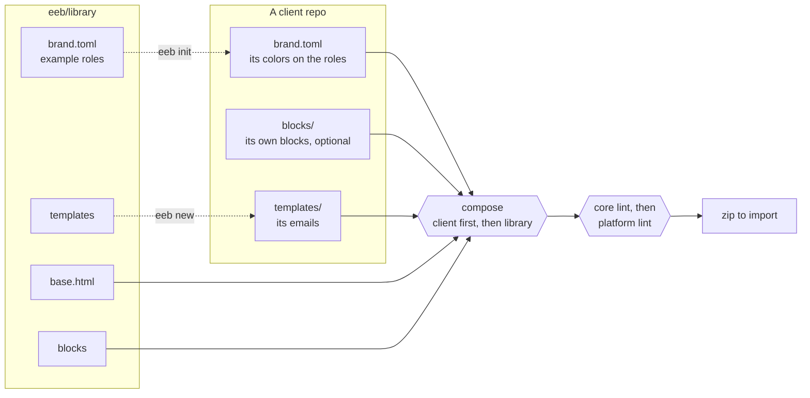

# Editable email builder

Build email templates that stay editable inside your email platform. Every text, button and photo opens in the platform's editor, and colors and sizes change from its style panel. Nothing is pasted in as a block of code that only a developer can touch.

The first supported platform is Mailchimp, through its template language. The builder keeps the platform at the edge: blocks are written once in neutral markup, and an adapter translates them for each platform.

## What you get

- **A library of 41 blocks.** Headers, text, images, products, offers, orders, countdowns, comparisons, testimonials, FAQs, events and footers. `python3 -m eeb blocks` lists each one with its fields.
- **95 starting templates.** Welcome, newsletter, promotion, product launch, abandoned cart, order confirmation, shipping update, review request, event invitation, birthday, back in stock, flash sale, how-to guide, year in review, milestone, blog digest, holiday greeting, price drop, gift card and more. `python3 -m eeb templates` lists them, and the [Figma kit catalog](docs/catalog.md) says which ones come from a licensed Figma kit.
- **A brand made of roles.** Every block paints with eight color roles and two font stacks from `brand.toml`. A client maps its design system onto those roles once, and the whole library takes its look.
- **A lint that explains itself.** 33 rules check editability, contrast, email client support, brand and legal requirements, plus what the platform needs. Each finding says why the rule exists. When a rule fails, no zip is written.
- **Tests that prove it.** Every rule fires on a planted violation, every library template builds clean, and every block is used by a template.

## Quick start

You need Python 3.11 or later. `preview` and `image` also need Pillow and Playwright.

1. Look at a library template at desktop and mobile widths:

	```sh
	pip install pillow playwright && playwright install chromium
	python3 -m eeb preview welcome
	```

	Library templates are examples: they build for preview and never get a zip.

2. Start a real email from it, then replace its links, texts and sample images:

	```sh
	python3 -m eeb new spring-welcome --from welcome
	```

3. Build it. The build refuses until no placeholder link (rule C4) and no sample image (rule C10) is left:

	```sh
	python3 -m eeb build spring-welcome
	```

4. In Mailchimp, create a template with **Import HTML**, upload `dist/mailchimp/spring-welcome.zip` and open it with the classic email builder.

To use the library for a client, follow [Set up a client repo](docs/client-repo.md).

## How it works



[How it works](docs/how-it-works.md) explains the neutral markup, the adapters and the lint layers.

## Documentation

- [How it works](docs/how-it-works.md): the pipeline, the library, the neutral markup and why it is built this way.
- [Set up a client repo](docs/client-repo.md): bring the library to a client and map its brand.
- [Build a new email from a Figma design](docs/new-email.md): the steps, from the frame to the import.
- [Blocks](docs/blocks.md): the brand roles, block ids and the conventions for a new block.
- [Mailchimp](docs/mailchimp.md): how the template language behaves, and what no rule can check.
- [Add an email platform](docs/adding-an-adapter.md): what an adapter needs and what to find out first.
- [Figma kit catalog](docs/catalog.md): each template of the licensed Figma kit, section by section, with the block that draws it.

## Commands

| Command | What it does |
|---|---|
| `python3 -m eeb templates` | List the library templates |
| `python3 -m eeb blocks` | List every block with its fields and editable names |
| `python3 -m eeb init` | Copy the library `brand.toml` into the current repo |
| `python3 -m eeb new <name> --from <template>` | Start a new email from a library template |
| `python3 -m eeb build <template> [--esp NAME]` | Compose, lint, translate, lint again and write the zip. Examples get no zip |
| `python3 -m eeb preview <template> [--esp NAME]` | Build, then take screenshots at 700 and 375 px |
| `python3 -m eeb image <src> <dest> --width N` | Crop, scale, darken and compress an image. Rasterizes SVG |
| `python3 -m eeb rules [--esp NAME]` | List the rules and their reasons |
| `python3 -m eeb esps` | List the supported platforms |
| `python3 -m unittest discover -s tests -t .` | Prove that every rule fires and every template builds |

## License

MIT. See [LICENSE](LICENSE).
