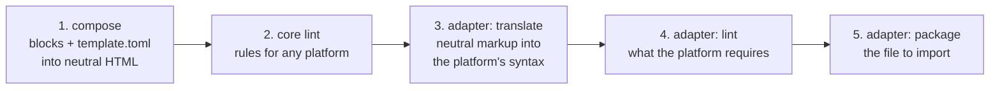
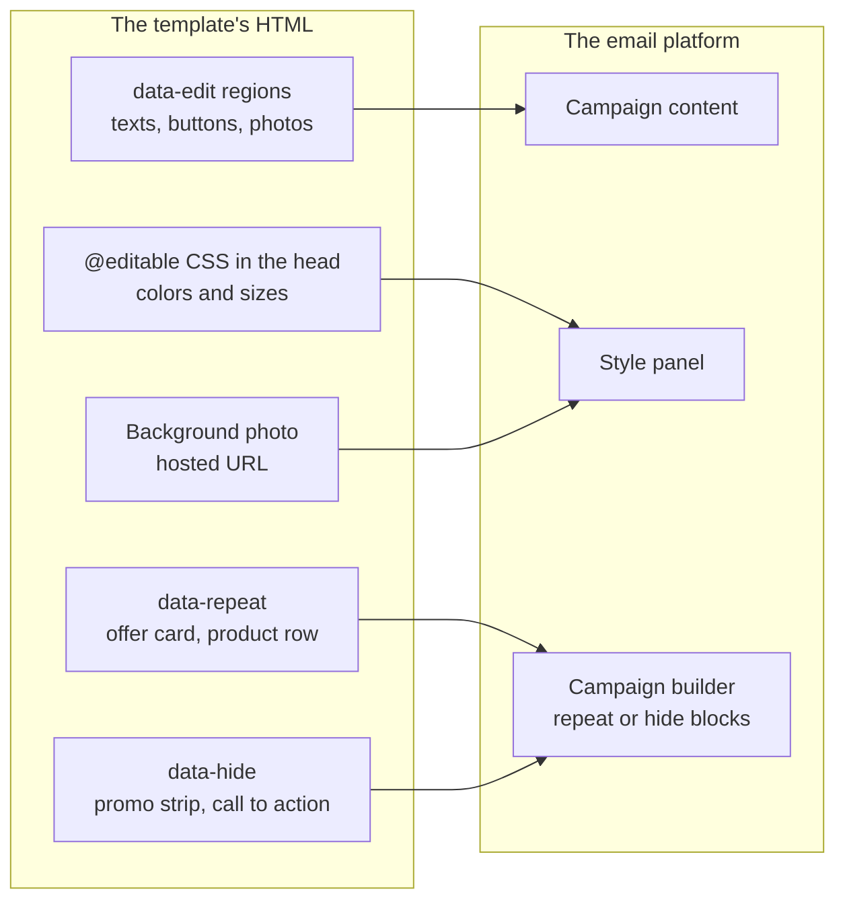
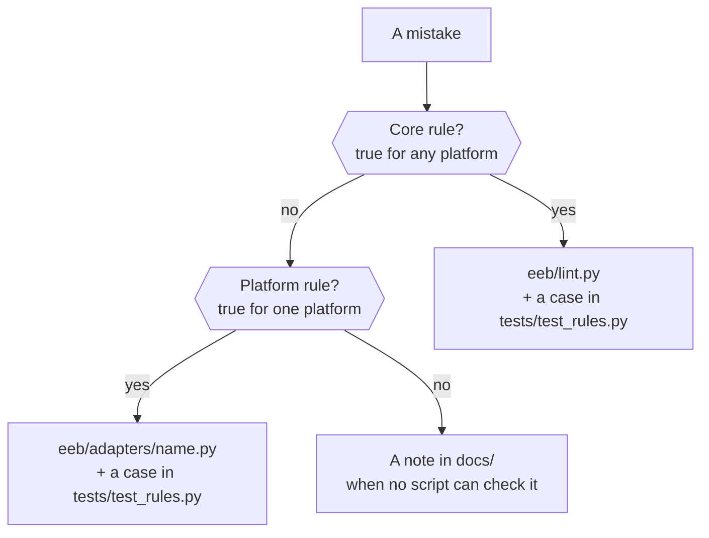

# How it works

An email template is editable when the person running a campaign can change every text, button and photo without touching code. Each platform marks editable regions its own way. Mailchimp uses `mc:edit`, and other platforms use their own attributes. This builder writes the design once, in neutral markup, and translates it at the end.

## The pipeline

1. **Compose.** `eeb/compose.py` fills each block with the content from `template.toml` and the roles from `brand.toml`, then places the blocks inside `base.html`. A block used twice gets its `id` on every editable name. Merge tags stay as `{{esp.*}}` tokens.
2. **Core lint.** `eeb/lint.py` checks the neutral HTML: every text is editable, styles live where the style panel can change them, links and images work in email clients, colors and fonts belong to the brand, and the legal footer is there.
3. **Translate.** The adapter turns the neutral annotations and tokens into the platform's syntax.
4. **Platform lint.** The adapter checks what its platform requires, such as Mailchimp's zip limits or its rules for repeatable blocks.
5. **Package.** The adapter writes the file the platform imports. When any rule fails, the zip is deleted.

## The library

`eeb/library/` holds a `brand.toml` with example roles, the base document, every block and the starting templates, with their sample images in `eeb/library/img/`. A project only adds what is its own:

- `brand.toml`: its colors and fonts on the same roles.
- `blocks/`: blocks the library lacks, or a client version of a library block with the same name.
- `templates/`: its emails, usually started with `eeb new` from a library template.

When `compose` needs a file, it looks in the project first and in the library second. A template can point at a library image with `library:name.jpg`, so a copied template builds before its images are replaced.

Because the library lives inside `eeb/`, copying the engine into a client repo brings every block and template with it.

## The neutral markup

Blocks never name a platform. They use these annotations, and each adapter maps them:

| Neutral markup | Meaning | Mailchimp |
|---|---|---|
| `data-edit="name"` | An editable region: text, button or image | `mc:edit="name"` |
| `data-label="Header: title"` | The region's name in the editor | `mc:label` |
| `data-repeat="name"` | A block the editor can repeat | `mc:repeatable="name"` |
| `data-variant="name"` | One layout among several of a repeatable block | `mc:variant` |
| `data-hide` | A block the editor can hide | `mc:hideable` |
| `/* @group Tab / Section */` | Names a CSS rule in the style panel | `@tab` and `@section` |
| `/* @editable */` | A CSS property the style panel can change | `/*@editable*/` |
| `{{esp.unsubscribe_url}}` and the other `{{esp.*}}` tokens | Merge tags | `*\|UNSUB\|*` and the rest |

`eeb/adapters/__init__.py` lists every `{{esp.*}}` token. An adapter that does not map all of them cannot be loaded.

## Where each part is edited

## Why the look lives in the head

Inside an editable region the content is plain HTML: `h1`, `h2`, `p`, `a`, `strong`. The look comes from a class on the region's container, defined in the `<head>`. That has two effects:

- When someone retypes a text in the editor, the style stays, because it never belonged to the text.
- The style panel can change it, because an inline style would override the panel.

Rules E2 and E6 keep it that way. Layout that nobody should edit, such as paddings and borders, stays inline. The platform inlines the rest when it sends the email.

## Why editable names come from the block

A block fixes its editable names, so the same names appear in every template that uses it. A platform keeps content by name, so a campaign keeps its text when it switches between your templates. A template that needs a block twice gives each use an `id`, which is added to its names. Inside a campaign, the person editing repeats blocks marked repeatable.

## Why some photos need a hosted URL

A photo inside an `` travels in the zip, and the platform uploads it on import. A background photo lives in CSS (`url()`), and at least Mailchimp does not upload it. That photo must already be hosted, for example in the platform's file manager, and its https URL goes in the template. The `hero_image` block avoids the problem with an ``. The `hero_background` block puts text over the photo and needs the URL.

## The lint layers

A lesson becomes a rule whenever a script can check it. A rule without a planted case fails the test suite, so every rule is proven to fire.
